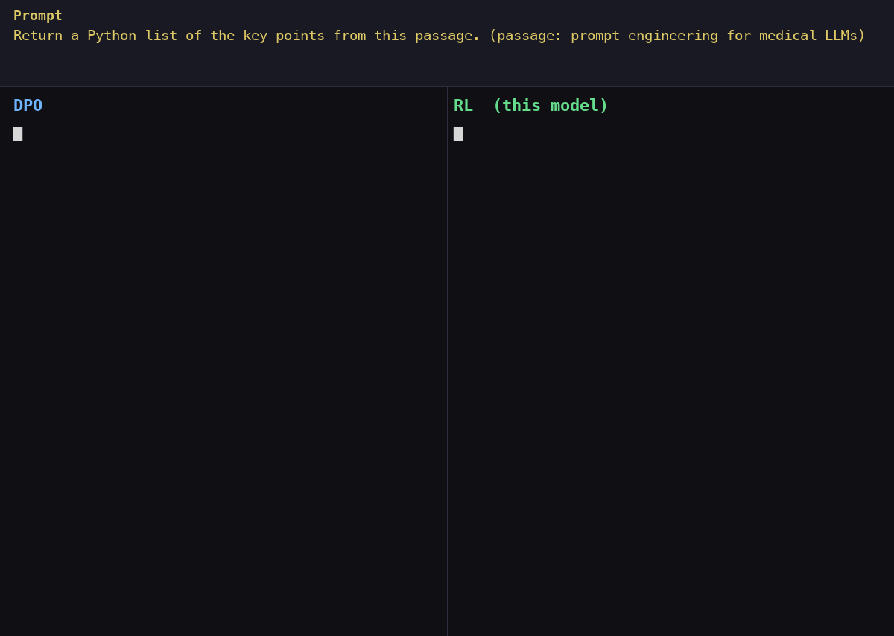

# post-training-experiments

A full post-training pipeline on **SmolLM-135M** (135M params): **CPT → SFT → DPO → RL**. Each stage is a self-contained experiment with its own `pyproject.toml`, `uv.lock`, and experiment log.

## Pipeline

```
SmolLM-135M (base)
   → CPT   domain-adapt on arXiv ML papers
   → SFT   instruction-tune into a structured paper-research assistant
   → DPO   align on LLM-ranked preferences
   → RL    reward structured reasoning and output format with GRPO
```

The RL stage trains on a separate reasoning base model, not on the DPO model.

## Stages

| Stage | Folder | What | Best model |
|---|---|---|---|
| **CPT** | [`cpt/CPT_SmolLM135M`](cpt/CPT_SmolLM135M) | Continued pre-training on arXiv ML papers | [`JaydeepR/SmolLM-135M-CPT-LoRA-r32`](https://huggingface.co/JaydeepR/SmolLM-135M-CPT-LoRA-r32) |
| **SFT** | [`sft/SFT_SmolLM135M`](sft/SFT_SmolLM135M) | Instruction tuning → `PaperResearcher` task API | [`JaydeepR/SmolLM-135M-SFT-exp01`](https://huggingface.co/JaydeepR/SmolLM-135M-SFT-exp01) |
| **DPO** | [`dpo/DPO_SmolLM135M`](dpo/DPO_SmolLM135M) | Preference optimization (DPO/ORPO) | [`JaydeepR/SmolLM-135M-neuraltxt-dpo-v1`](https://huggingface.co/JaydeepR/SmolLM-135M-neuraltxt-dpo-v1) |
| **RL** | [`rl/RL_SmolLM135M`](rl/RL_SmolLM135M) | GRPO on reasoning and output format | [`JaydeepR/SmolLM-135M-neuraltxt-grpo-v1`](https://huggingface.co/JaydeepR/SmolLM-135M-neuraltxt-grpo-v1) |

Each stage folder has its own README with a quickstart. Derived from the [Neural Breakdown finetuning-recipes](https://github.com/avbiswas/finetuning_recipes) course.

## The Experiment Loop

Every experiment follows this loop:

```
Set up Dataset + Eval Harness
         ↓
    Run Experiment
         ↓
   Track Metrics
         ↓
Hypothesize & Plan Next
         ↑_____________|
```

## Results

### CPT — perplexity / ROUGE / BERTScore on held-out arXiv abstracts

| Model | Perplexity | ROUGE-1 | BERTScore F1 | vs Base |
|---|---|---|---|---|
| SmolLM-135M (Base) | 22.97 | 0.178 | 0.736 | — |
| Full Fine-Tuning (bf16) | 22.88 | 0.170 | 0.737 | ❌ worse on ROUGE |
| LoRA r=8 | 18.42 | 0.209 | 0.748 | +17.4% ROUGE |
| LoRA r=16 | 18.39 | 0.207 | 0.752 | +16.3% ROUGE |
| **LoRA r=32** | **18.36** | **0.213** | **0.753** | **+19.7% ROUGE ✦ best** |
| Interleaved + LoRA r=16 | 18.40 | 0.204 | 0.753 | +14.6% ROUGE |
| Interleaved + rsLoRA r=16 | 18.58 | 0.213 | 0.756 | +19.7% ROUGE |

### SFT — LLM-as-judge (grok-3-mini) on 1000 held-out instructions

`exp01_cpt_sft`: overall **2.39/5** (relevance 3.04 > faithfulness 2.70 > correctness 1.98 ≈ completeness 1.85). The model learns task *shape* but is capacity-limited on factual recall at 135M.

### DPO — `dpo_default` (β=0.1, LoRA r=32, 3 epochs)

| Metric | SFT baseline | DPO |
|---|---|---|
| Eval loss | — | **0.457** |
| Reward accuracy (held-out) | 0.50 | **0.72** |
| Diversity (EAD / SBERT / Vendi) | 0.117 / 0.226 / 2.73 | 0.119 / 0.232 / 2.74 |

Learned the preference (reward accuracy 0.50 → 0.72) **with no mode collapse** — diversity is flat vs the SFT baseline.

### RL — GRPO, 24 hours on an H100, 256 held-out prompts

| Metric | Early (cycle 5) | Late (cycle 1,495–1,500) |
|---|---|---|
| Correct output format | 89.8% | **99.2%** |
| Word overlap with reference (F1) | 0.436 | 0.445 |

| Metric | DPO | RL |
|---|---|---|
| Correct output format | 95.7% | **99.2%** |
| Median answer length | 49 words | 33 words |

A blind LLM judge picked cycle 1,495 over cycle 5 54.3% of the time (± 6.1), which isn't statistically significant. The judge didn't compare DPO and RL directly.



*Selected prompts where RL beats DPO. They show the format gap, not typical answer quality.*

## Key Learnings

- **CPT:** LoRA beats full fine-tuning on small data; rank (r=8/16/32) barely matters — data is the bottleneck.
- **SFT:** train/eval gap is tiny — the 135M model is capacity-bound, not data-bound; 3 epochs is the plateau.
- **DPO:** preference tuning works at 135M and (at β=0.1) preserves diversity; mild overfitting (train acc ~0.85 vs eval 0.72) is the limit, so more epochs won't help — a lower β is the lever.
- **RL:** format improved but answer quality stayed about flat, and the reasoning became formulaic. Format made up about 2 of the 2.55 reward points at the best checkpoint, and the only content score was semantic similarity to a reference answer. Next is penalising claims the passage doesn't support.

## Stack

`PyTorch` · `Transformers` · `Unsloth` · `TRL` · `PEFT` · `sentence-transformers` · `W&B` · `uv` · `Python 3.12`

## Adding New Experiments

Add as a sibling folder under the relevant stage (e.g. `cpt/CPT_SmolLM360M/`) or a new top-level stage dir. Keep each experiment self-contained: its own `pyproject.toml`, `uv.lock`, `README.md`, and `experiments.md` / `LEARNINGS.md`.
