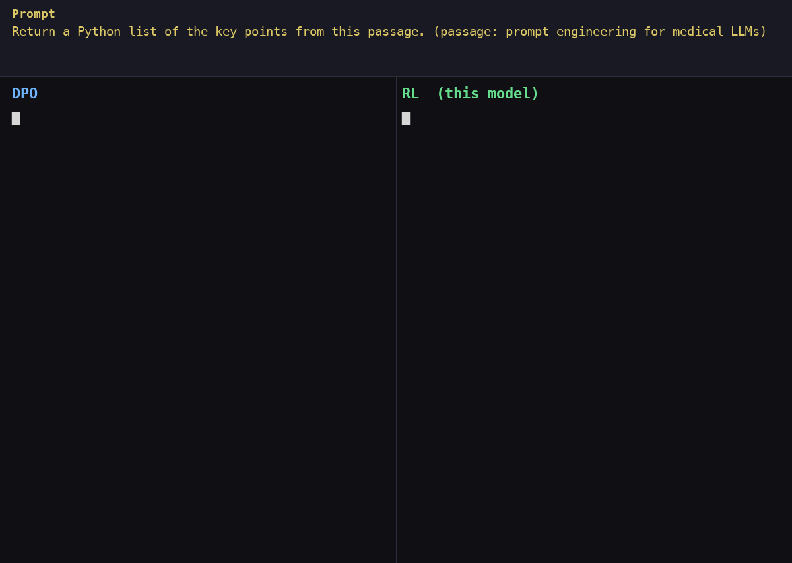

# RL_SmolLM135M

GRPO on SmolLM-135M: teach the reasoning base model to produce better `<think>…</think>` + answer responses, scored by a learned reward model plus format, schema, doom-loop, and length checks. Ported from [finetuning_recipes](https://github.com/avbiswas/finetuning_recipes).

## Results

Best checkpoint: cycle 1,495 of about 1,500, from 24 hours on an H100 on Modal. Total Modal spend was $106, including crashed runs. All numbers use 256 held-out prompts.

| Metric | Early (cycle 5) | Late (cycle 1,495–1,500) |
|---|---|---|
| Correct output format | 89.8% | **99.2%** |
| Word overlap with reference (F1) | 0.436 | 0.445 |

| Metric | DPO | RL |
|---|---|---|
| Correct output format | 95.7% | **99.2%** |
| Median answer length | 49 words | 33 words |

A blind LLM judge (`reasoning/judge_head_to_head.py`) compared later checkpoints with cycle 5. Cycle 1,495 won 54.3% (± 6.1) and cycle 1,515 won 51.4% (± 6.1), and neither is statistically significant. The reasoning also became formulaic, with many responses starting "The passage explicitly states...". The judge didn't compare DPO and RL directly.



*Selected prompts where RL beats DPO. They show the format gap, not typical answer quality. To regenerate: `uv run --with pillow python make_dpo_vs_rl_gif.py` (macOS, uses Menlo).*

## Reward

Responses must put reasoning in one `<think>…</think>` block, followed by only the final answer. The reward is the sum of:

| Component | Checks | Score |
|---|---|---|
| Think format | The layout above is correct | +1 or 0 |
| Output datatype | Same type as the reference, such as JSON or a Python list | +0.5 or -0.5 |
| Output schema | Same structure as the reference | +0.5 or -0.5 |
| NeuralTxt | Semantic similarity to the reference | Raw model score |
| Repetition | Same word more than 3 times in a row | -1 or 0 |
| Length | Answer longer than `max(2 × reference words, reference words + 30)` | -0.5 or 0 |

If the think format fails, datatype and schema each score -0.5, and NeuralTxt and length score 0.

## Config

`reasoning/grpo/modal_gpu.yaml`: `dr_grpo` loss, LoRA r=32 and alpha=64, 50,000 ML paper prompts (prompts too long for the model's context are filtered out), learning rate 5e-6, KL weight 0.02, temperature 0.5, up to 640 new tokens, effective batch size 32 (micro-batch 4 × 8 accumulation steps).

## Layout

| Path | What |
|---|---|
| `reasoning/env.py`, `schema_match.py` | Reward function shared by training and evals |
| `reasoning/grpo/` | GRPO trainer, rollouts, loss, and YAML configs |
| `reasoning/eval_*.py`, `*_head_to_head.py` | Checkpoint evals |
| `reasoning/EVALUATION.md` | Reward design, diagnosis, and results from upstream |
| `reward_models/` | Reward model training and `REWARD_MODEL_FINDINGS.md` |
| `data_prep/` | Reasoning data, rollouts, confounds, and reward benchmarks |
| `merge_adapter.py`, `mlx_export.py` | Merge a checkpoint and convert it to MLX |

## Quickstart

```bash
uv sync                                  # GRPO only; add --extra warmup/dataprep/mlx as needed
.venv/bin/python -m unittest tests/reasoning/test_*.py reasoning/tests/test_schema_match.py

# Tiny end-to-end check
.venv/bin/python reasoning/grpo/train.py reasoning/grpo/smoke.yaml -o smoke

# Train on a shared machine (memory cap + watchdog)
./run_guarded.sh reasoning/grpo/dgx_spark.yaml grpo_dgx_v1
```

Run everything from this folder. Checkpoints and logs go to `models/<output_model_id>/`: `llm` (latest), `llm_best_<n>` (best eval reward so far), `logs/train_metrics.jsonl`, and `logs/eval_generations_*.json`.

## Changes from upstream

- Configs use the public `paperbd/neuraltxt-v1-135M-reasoning-base-v2` and `paperbd/paper_instructions_300K-v1`; the `-v2` dataset is not publicly accessible.
- `train.py` falls back to `sdpa` when flash-attn isn't installed, honours `max_gpu_memory_gb`, and saves a final checkpoint.
- `reasoning/grpo/dgx_spark.yaml` and `run_guarded.sh` are new, for the shared DGX Spark.
- Some upstream reward datasets (for example `reward_model_dataset_clean.jsonl`) aren't published, so `data_prep/eval_reward_models.py` can't run as-is.
